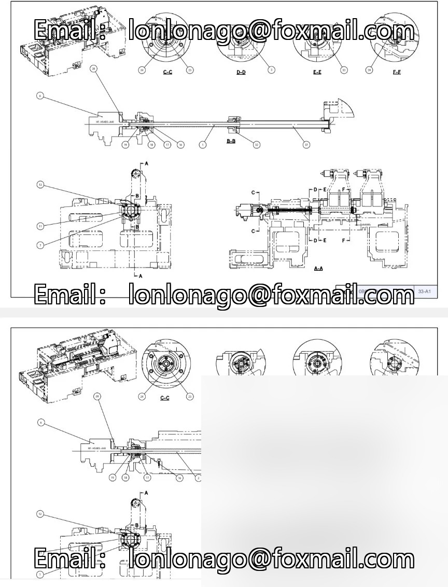

# Mazark QSM150 CNC lathe materials

## Body

Mazak (Mazak) QSM150 series CNC lathe data
Mazak (Mazak) QUICK TURN SMART 150 series (abbreviated as QSM150) CNC diagonal bedhead lathe / turning center.
PDF document 259 pages
Turret (Turret) unit materials
402750

The materials cover Mazak QSM150 CNC lathe, the series name, PDF documents, turret unit information and a specified document number.

<!-- AI_ENRICHED -->

## Images

## Payment

Here is a pay link on Stripe ( https://buy.stripe.com/3cs8yP7sY87d0vu9AB ). Please contact me lonlonago@foxmail.com after funding $89, and I will send you a complete data files , thank you!

